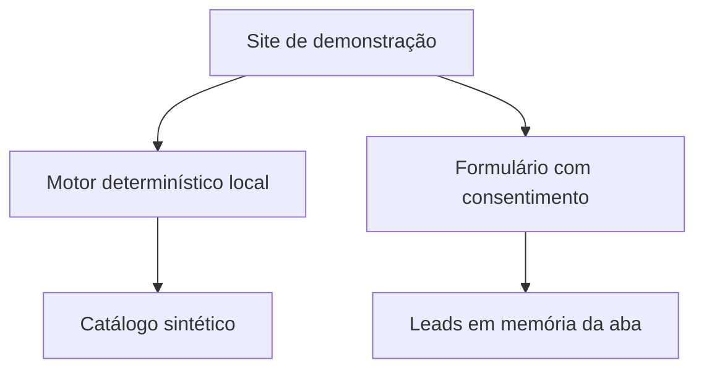
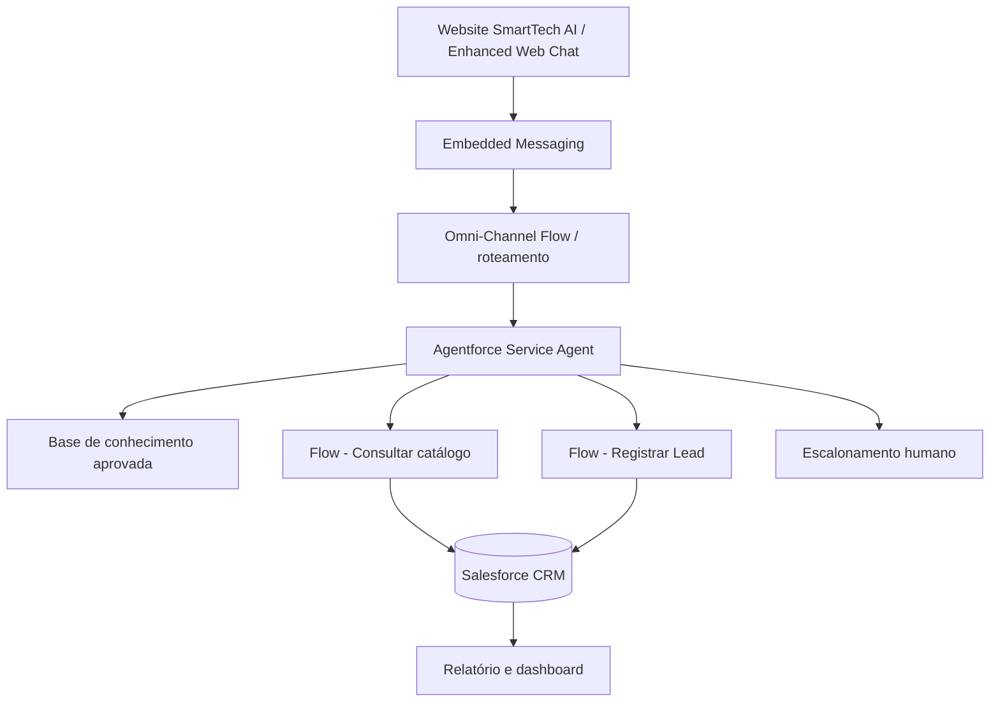

# Arquitetura — SmartTech AI

## Estado v0.1 (demonstrável)

**Importante:** esta versão não utiliza LLM, Agentforce, Data 360 ou Salesforce CRM em produção. Ela é uma interface demonstrativa + protótipo funcional de regras e validações.

## Arquitetura-alvo (a implementar)

### Componentes e responsabilidades

| Componente | Implementação alvo | Evidência necessária |
| --- | --- | --- |
| CRM | Lead, Product2, Opportunity (opcional) | prints e registros de teste |
| Agentforce | subagente Pré-Vendas e suas instruções | agente ativado, teste de intenções |
| Salesforce Flow | `Consultar_Produto`, `Registrar_Lead` | execuções verificadas |
| Base de conhecimento | FAQs validadas da empresa fictícia | respostas sem alucinação |
| Site | Enhanced Web Chat / Experience Cloud | vídeo do chat real |
| Monitoramento | relatório de Leads por origem e status | dashboard e critérios |

Não colocar no GitHub tokens, senhas, IDs sensíveis, URLs restritas, dados de clientes, exports de processos judiciais ou capturas com informações privadas.
